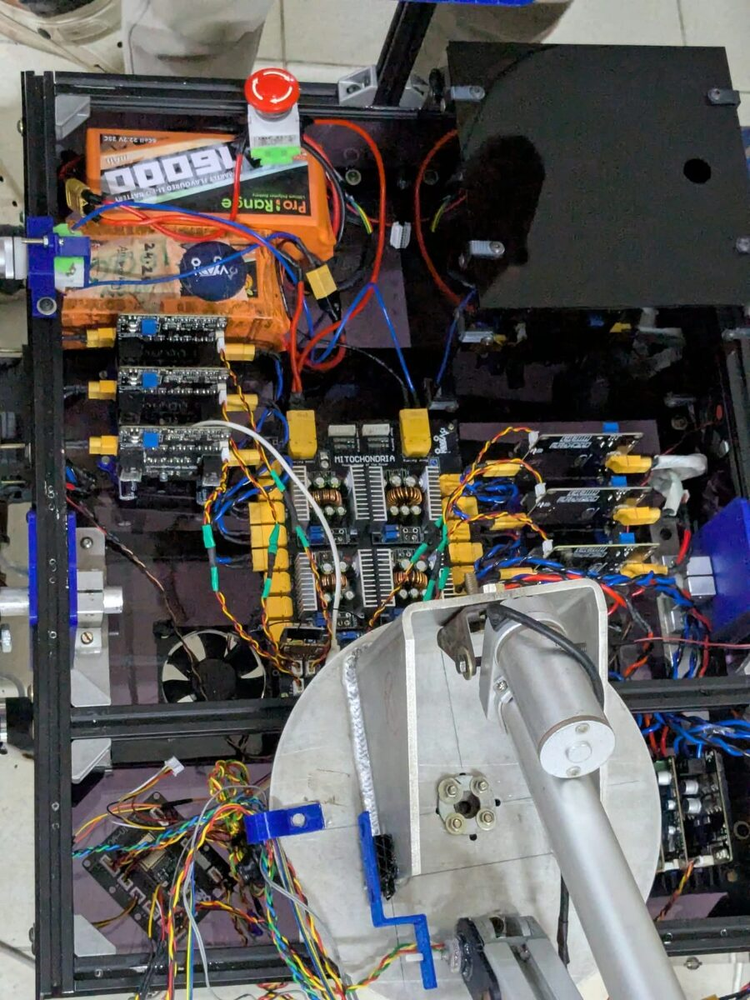
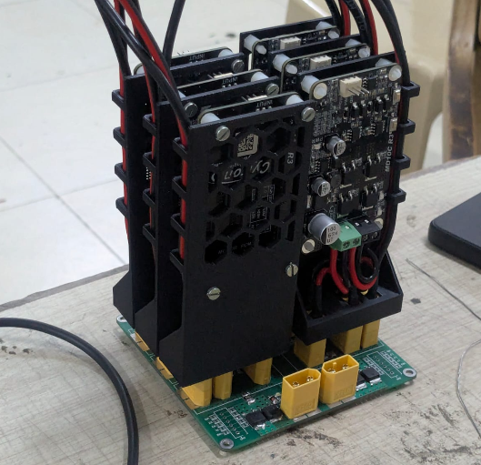
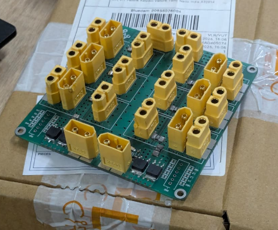
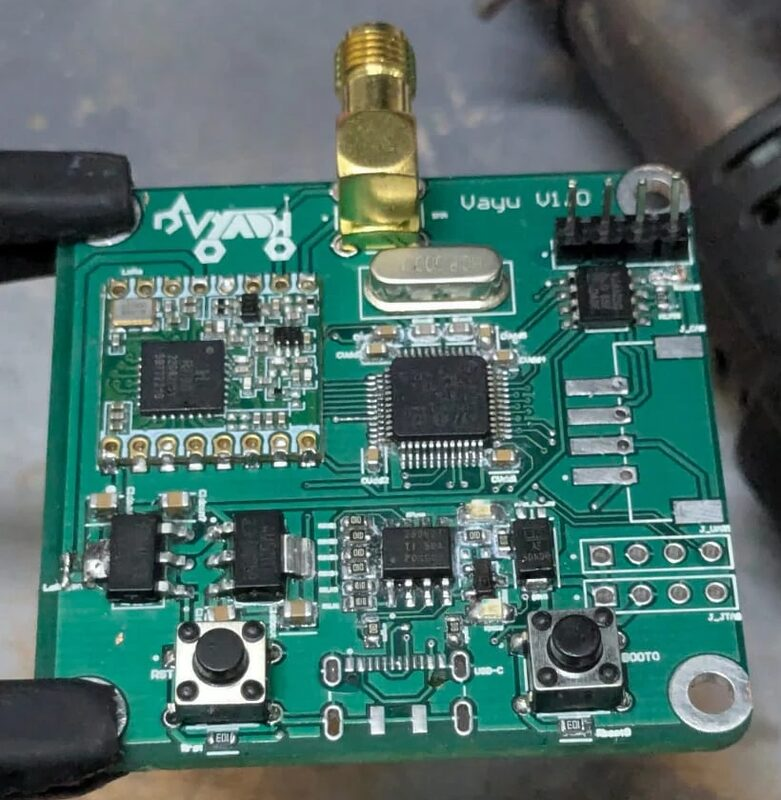
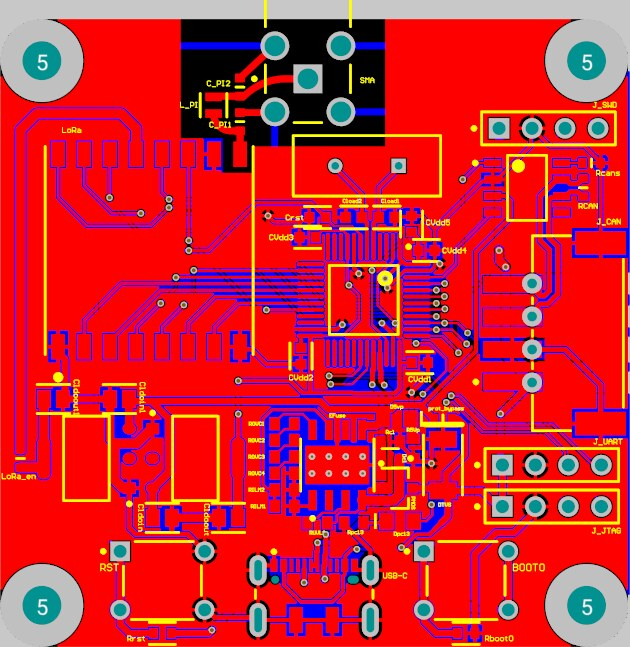
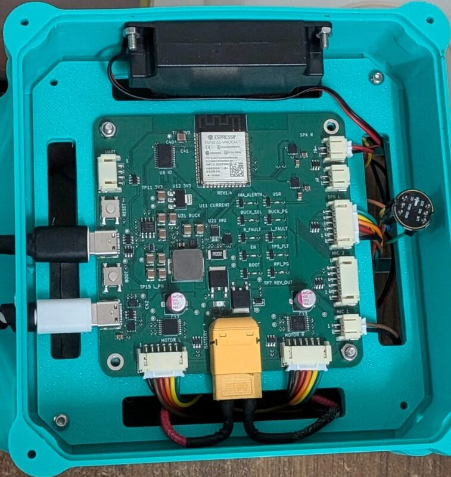
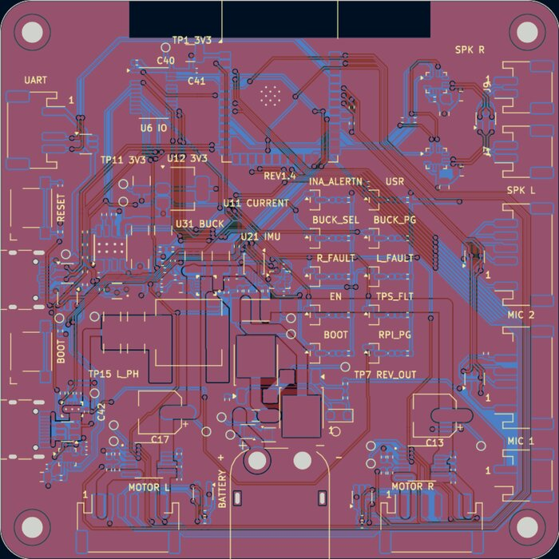
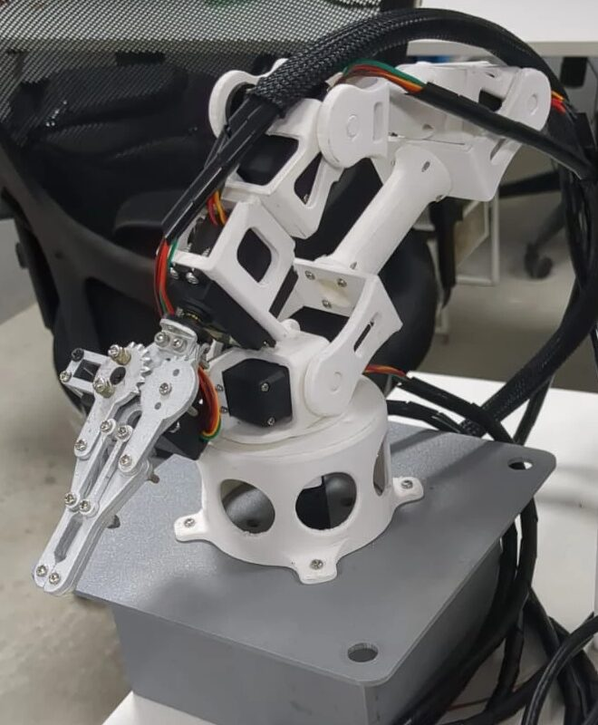
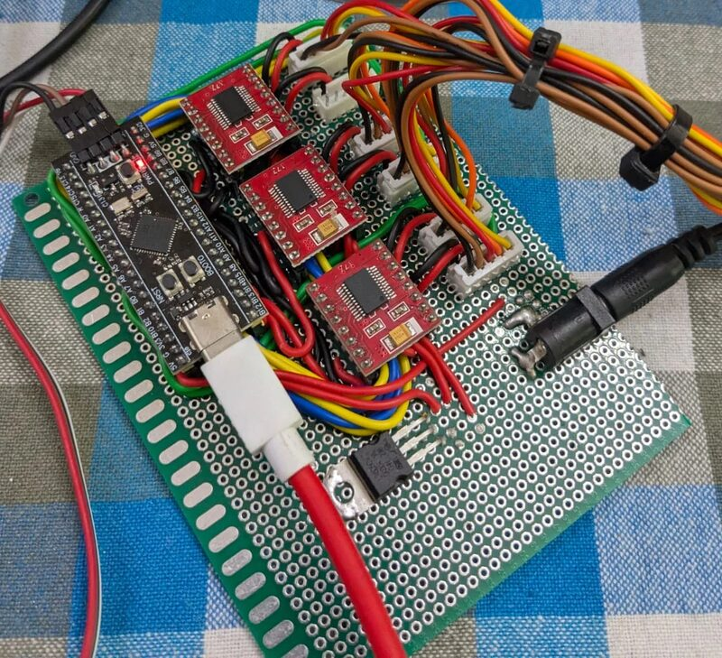

# Anbu

Electronics & Embedded Systems | PCB Design | Firmware

If you look at the engineering iceberg, you'll find me around the hardware-firmware layer - I design the boards, write the firmware that runs on them, and put it all together on real hardware.

> **Latest resume/CV:** [Google Drive](https://drive.google.com/drive/folders/1oRJanU7ESqI9qCizsij_A0dgBacmqvln?usp=sharing)  
> **Full portfolio:** [github.com/anbu-05/Portfolio](https://github.com/anbu-05/Portfolio)

  

---

## Mars Rover - Team Vyadh

two years on a 33-member rover team, from electrical junior to Electrical Head. most of what i know about hardware came from this.

as Electrical Head i led the 6-member electrical domain - timelines, budget, inventory, and getting 3 juniors to where they can handle most technical work on their own.

- moved every rover node to **STM32** and put all 6 of them on a **CAN bus** - noise immunity and hot-swapping in a drivetrain full of EMI
- set the team's PCB rules: protection circuitry on every board, and standard board sizes so designs can share a panel and cost less to fab
- built a **LoRa RF link (SX1278)** for 1 km bidirectional control and telemetry - unlike an off-the-shelf RC, it carries mixed data (arm position, science feedback, encoder states)

this is the inside of the rover. my senior designed the multi-rail buck board in the middle (Mitochondria) - i built the rest of the electronics around it.

  

a power distribution board for six slot-in Cytron MD10C motor drivers: >80 A continuous at 24 V, per-rail current sensing, all inside 100 x 100 mm

  
  

and an **STM32F103 + LoRa** board to put the radio link on one PCB. rev 1 is built - bring-up found a power issue, and rev 2 fixes it.

  
  

[more of my PCBs](https://github.com/anbu-05/Portfolio/blob/main/pcb-design/README.md)

---

## Turtlebot Controller Board - Intuitive Evolution

remote internship, Sep 2026 - present. one **ESP32-S3** board that replaces four hobby modules on a small robot.

- fused, reverse-polarity-protected battery input, and a **USB-C PD source (FUSB302)** that gives the Raspberry Pi 5 its full 5 V / 5 A
- battery monitoring, IMU, stereo I2S audio, fault reporting, and **15 A power distribution** for two encoder DC motors - every subsystem worked on the first build
- **ESP-IDF / FreeRTOS** bring-up firmware with host-side unit tests and a 1 kHz logger. a 1-hour full-system stress test ran with zero errors, and traced the Pi's under-voltage to 0.2 Ω of cable loss
- requirements to an order-ready design in two weeks and five revisions, with BOM cost down 20%

  
  

---

## 6-DOF Robotic Arm

[github.com/anbu-05/Robotic-Arm](https://github.com/anbu-05/Robotic-Arm)

an **STM32F411** driving six motors with closed-loop position control from ADC feedback (DMA + filtering). a USB serial command line lets me tune it live without reflashing.

  
  

---

## Others

- **RISC-V SoC** - PicoRV32 with a custom AXI4-lite interconnect, SRAM, UART and GPIO ([Tetrel-RISCV](https://github.com/anbu-05/Tetrel-RISCV))
- **PLC conveyor** - a PLC-controlled conveyor built from modular Function Blocks, tested in FactoryIO and S7-PLCSIM ([repo](https://github.com/anbu-05/PLC-controlled-conveyor-system))

---

## Skills

**Embedded & Firmware** — C, C++, Python, ESP-IDF, FreeRTOS, STM32 HAL, bare-metal, UART, SPI, I2C, I2S, CAN, MQTT  
**Hardware & PCB** — KiCad, Altium, schematic capture, layout & routing, power distribution, USB-C PD, protection circuitry, DFM for assembly, bring-up, SMD soldering  
**RTL** — Verilog, SystemVerilog, AXI4-lite, FPGA (Cyclone IV, DE2-115)  
**Mechanical** — Fusion 360, 3D printing  
**Tools** — Git, STM32CubeIDE, RISC-V GCC toolchain, QuestaSim  
**Automation** — Siemens S7-1500, TIA Portal

---

## Find me

- 📧 anbuazhagudurai1@gmail.com
- 💼 [linkedin.com/in/anbu2005](https://linkedin.com/in/anbu2005)
